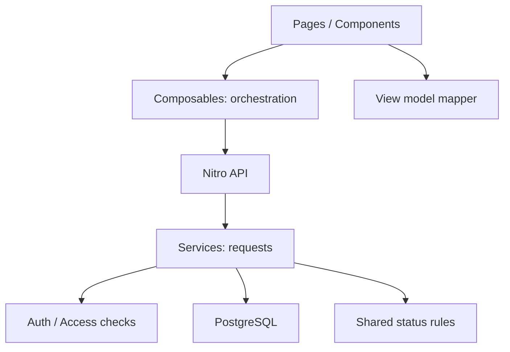

# Архитектура WorkFlow

UI получает view-модели. HTTP-модели преобразуются в одном request-mapper. useFetch владеет server state, URL — фильтрами, Pinia — настройками. API валидирует ввод, сервис заявок проверяет роли, блокирует строку на время изменения и вызывает общие правила перехода. Shared зависит только от TypeScript.

Домены: requests — жизненный цикл заявки; comments — отдельные записи с идемпотентным ключом; users — аккаунты и роли; customers — справочник клиентов; auth — сессии; notifications появится на уровне 8. SQL доступен только серверу. App не импортирует server, server не импортирует app.

## ADR-1: локальная Pinia
Pinia хранит только настройки UI. Заявки остаются в useFetch; дублирование server state создало бы два источника истины. Цена — ручная invalidation после мутаций.

## ADR-2: сервис заявок
Из API вынесены доступ и транзакции в services/requests. HTTP детали остаются в обработчиках. Цена — пока сервис принимает H3Event, что упрощает миграцию, но связывает его с Nitro; последующая итерация может передавать явный actor и DTO.

## ADR-3: JSONB
Записи в PostgreSQL используют JSONB для эволюции учебных моделей, а сессии и комментарии имеют отдельные таблицы и внешние ключи. Цена — меньше ограничений БД для полей JSON, поэтому валидация обязательна. Для большой базы стоит нормализовать status, priority, customer и добавить индексы; текущая фильтрация в памяти не рассчитана на большой объём.

Nuxt Layers не добавлены: самостоятельные снимки уровней проще проверить без зависимости от соседних папок.
