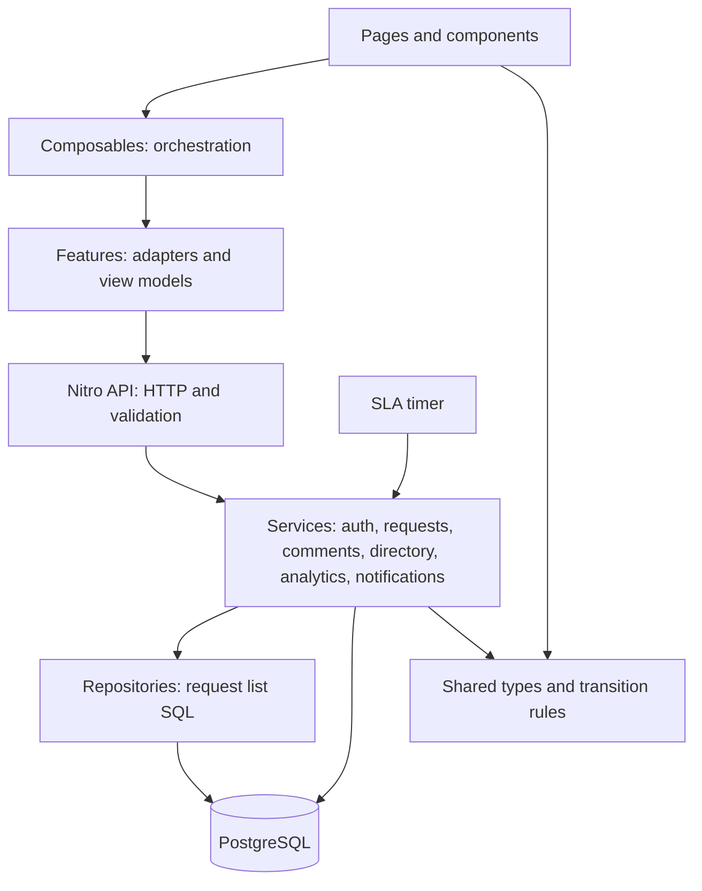

# Архитектура WorkFlow

`app/features` содержит домены requests, customers, users, categories, comments, auth, notifications. Компоненты отвечают за отображение, composables — за загрузку и координацию, feature adapters — за HTTP-контракт и преобразование моделей. Совместимые старые composables переэкспортируют реализацию из features; отдельного второго состояния нет.

API проверяет вход и HTTP-статусы. Сервисы выполняют авторизацию, транзакции и бизнес-правила. Request repository выполняет фильтрацию, сортировку и пагинацию SQL с ролью в WHERE; CTE возвращает страницу и total из одного snapshot. Некоторые сервисы пока принимают H3Event — связь с Nitro сохранена осознанно, отдельной независимой domain runtime библиотеки нет.

Правила переходов — `shared/utils/transitions.ts`, интерфейсы — `shared/types`. Shared не импортирует Vue, Nitro или app/server. App не импортирует server; server не импортирует app. `tests/architecture.mjs` проверяет границы и циклы явных импортов. Nuxt autoimports остаются для UI/framework helpers; это ограничение статической проверки, а не доказательство отсутствия любой возможной runtime зависимости.

Сессии, комментарии, файлы, уведомления и события истории — отдельные таблицы. Requests/users/customers/categories сохраняют гибкие поля JSONB. Для фильтров добавлены expression indexes, для email — case-insensitive unique index. Изменение заявки блокирует строку; комментарии имеют уникальный идемпотентный ключ. `request_events` сохраняет причину и deadline в момент события, чтобы аналитика не переоценивала прошлые решения по текущему SLA.

## ADR-1: один источник каждого состояния

Проблема: копии фильтров и заявок расходятся. Решение: URL хранит фильтры, useFetch — server state, Pinia — только настройки UI. Цена: после мутаций требуется явное обновление server state и rollback optimistic копии. Проверяем поисковую гонку, refresh и Undo браузером.

## ADR-2: JSONB плюс реляционная история

Проблема: учебная модель быстро меняется, но аналитике нужны надёжные даты и связи. Решение: оставить JSONB для документов, вынести события и связи в таблицы, фильтровать SQL, индексировать используемые выражения. Цена: часть полей всё ещё не защищена внешними ключами; требуется валидация и проверка удаления. Для большой нагрузки нужна дальнейшая нормализация и анализ EXPLAIN.

## ADR-3: самостоятельные снимки вместо Nuxt Layers

Проблема: каждый уровень должен запускаться из отдельной папки. Решение: независимые снимки и явные доменные адаптеры внутри каждого. Nuxt Layers не требуются для текущей задачи. Цена: исправления между уровнями переносятся явно; зависимости устанавливаются отдельно. В одном production-продукте предпочтительнее единый код и история Git.
