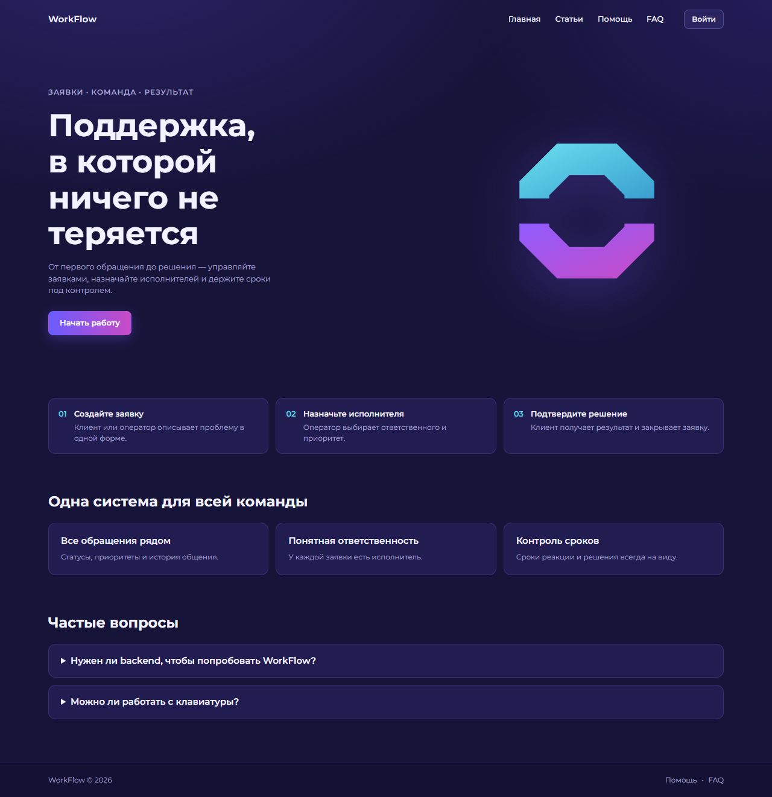
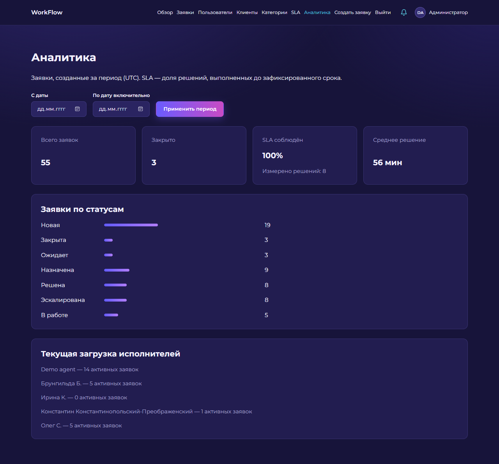

# WorkFlow

[](https://github.com/locas023/octagon3/actions/workflows/ci.yml)

Учебная система поддержки: клиент создаёт заявку, оператор назначает исполнителя, исполнитель фиксирует работу и решение. Администратор управляет справочниками, SLA и аналитикой. Четыре роли получают разные права на сервере и в интерфейсе.

Nuxt 4, Vue 3, TypeScript, Nitro, Pinia, PostgreSQL 17, Zod, Playwright, Vitest, Docker Compose. Это финальный самостоятельный снимок; папки 1–8 показывают предыдущие этапы.

## Демо и запуск

Публичное демо: **[octagon3-workflow.onrender.com](https://octagon3-workflow.onrender.com)** — Render Free + PostgreSQL Neon. После простоя первый запрос может занять около минуты. Локальный Docker demo: [127.0.0.1:3019](http://127.0.0.1:3019). Инструкция воспроизведения: [DEPLOY.md](docs/DEPLOY.md).

Из этой папки в PowerShell при запущенном Docker Desktop:

```powershell
powershell -NoProfile -ExecutionPolicy Bypass -File scripts/docker-start.ps1
```

Скрипт создаёт игнорируемый `.env.compose` со случайным паролем, собирает приложение, запускает миграции и seed, ждёт healthcheck. База не публикует порт на хост; данные сохраняются в именованном томе. [Подробности Docker](docs/DOCKER.md).

Без Docker: Node 22 и PostgreSQL 17, скопировать `.env.example` в `.env`, указать свой DATABASE_URL:

```powershell
npm.cmd ci
npm.cmd run db:setup
npm.cmd run dev
```

Dev URL: [127.0.0.1:3009](http://127.0.0.1:3009). `db:setup` по умолчанию создаёт базу при наличии соответствующих прав. Для заранее созданной базы задать `CREATE_DATABASE=false`.

Учебные аккаунты: `client@workflow.demo`, `operator@workflow.demo`, `agent@workflow.demo`, `admin@workflow.demo`. Общий демонстрационный пароль: `WorkflowDemo2026!`. Данные вымышленные; регистрация создаёт только Client.

## Возможности

- URL-фильтры, поиск с debounce, пагинация, пустые состояния и повтор загрузки.
- Optimistic priority, rollback при ошибках, Undo, идемпотентные комментарии.
- Серверные сессии, права четырёх ролей, профиль, CRUD пользователей/клиентов/категорий.
- История статусов и причин, сроки SLA, эскалация, уведомления read/unread, вложения с проверкой содержимого.
- Аналитика периода: статусы, исторический SLA, среднее время решения и текущая загрузка.
- SSR landing, FAQ, помощь и статьи с metadata, canonical, sitemap, robots и корректными 404.

## Архитектура и сложные места

UI обращается к feature-адаптерам и composables; Nitro вызывает сервисы и SQL repositories. Общие правила переходов не зависят от Vue. Состояние сервера живёт в useFetch, фильтры — в URL, настройки интерфейса — в Pinia.

Особого внимания потребовали конкурентная отправка комментария, сериализация JSONB, rollback с Undo, гонка поисковых запросов и сохранение исторического deadline для аналитики. Решения и ограничения: [ARCHITECTURE](docs/ARCHITECTURE.md), [TRADEOFFS](docs/TRADEOFFS.md), [REGRESSIONS](docs/REGRESSIONS.md), [AI_USED](docs/AI_USED.md).

## Проверки

```powershell
npm.cmd run typecheck
npm.cmd test
npm.cmd run lint
node tests/architecture.mjs
$env:TEST_URL='http://127.0.0.1:3019'
npm.cmd run test:integration
npm.cmd run test:business
node tests/integration/admin-analytics.mjs
npm.cmd run test:e2e
node tests/public-check.mjs
node tests/accessibility.mjs
```

Для E2E нужен Edge (`npx.cmd playwright install msedge`), для видео также `npx.cmd playwright install ffmpeg`. Тесты создают учебные записи. Проверка сохранности Docker-тома: `npm.cmd run test:docker`; она перезапускает контейнеры. Браузерных сценариев — 11; проверка доступности охватывает 35 сочетаний роли и маршрута, ширины 360/768/1280.

[GitHub Actions](https://github.com/locas023/octagon3/actions) проверяет финальный снимок с PostgreSQL на чистом runner. [Release audit](docs/RELEASE-AUDIT.md) отделяет выполненные проверки от ограничений.

## Performance и изображения

Диагностический Lighthouse mobile: LCP публичных страниц после оптимизации 0,76–0,91 с, CLS 0, performance 100. По одному локальному прогону; это не полевые метрики. Методика, baseline и сырые отчёты: [PERFORMANCE](docs/PERFORMANCE.md).




[Все снимки](docs/audit/screenshots), [видео](docs/demo/workflow-demo.webm), [сценарий демонстрации на 5 минут](docs/DEMO.md).
